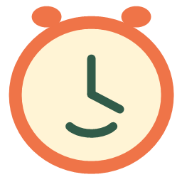
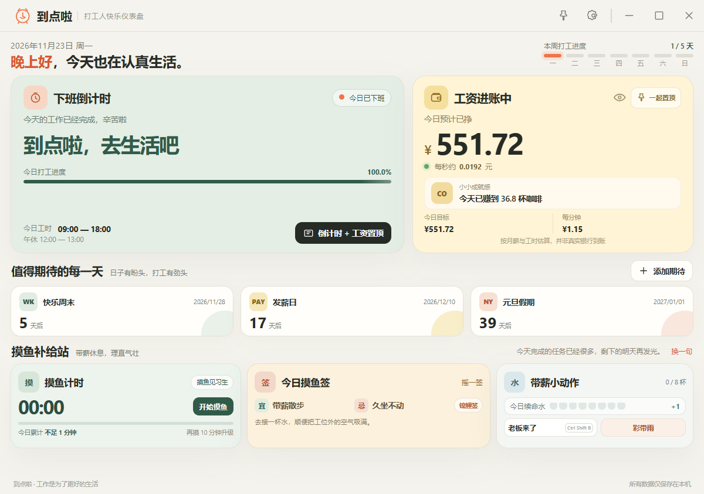
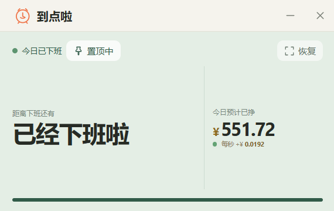

<p align="center">
  
</p>

<h1 align="center">到点啦 · 项目介绍</h1>

<p align="center"><strong>把上班最后三小时，变成一块会呼吸的小仪表盘。</strong></p>

<p align="center">
  
</p>

## 一句话介绍

“到点啦”是一款 Windows 桌面打工人情绪工具：它把下班倒计时、实时估算工资、假期与发薪日、摸鱼计时和喝水打卡，收进一块安静、温暖、不打扰工作的小仪表盘。

它不管理你，也不考核你。它只是让时间变得可见，让“今天还要上多久”有一个具体的答案。

---

## 为什么做这个

多数效率工具都在告诉你要更快、更专注、完成更多。但打工人真正盯着的，往往是另外几件事：

- 现在几点了，离下班还有多久；
- 今天已经挣到多少钱，这一秒又跳了多少；
- 距离周末、发薪日、下一次旅行还有几天；
- 今天有没有时间喝口水、站起来走两步；
- 老板走过来的时候，屏幕能不能立刻换一副面孔。

这些需求不大，却真实地构成了工作日里的每一个小情绪。“到点啦”没有试图解决宏大的职业问题，而是把这些问题做成一个轻量、可随身放在桌角的答案。

---

## 产品气质

### 1. 先有用，再有趣

下班倒计时和实时工资是主角，摸鱼玩法是配角。界面没有把核心信息埋进彩蛋里：打开应用，第一眼就能看到还剩多久下班、今天已经挣了多少。

### 2. 有情绪，但不吵闹

界面使用米白纸张、鼠尾草绿、奶油黄和一枚小小的橙色闹钟。信息密度不低，但用色柔和、层级克制。它希望像桌上一张便利贴，而不是一块不断闪红光的监控面板。

### 3. 数据留在本机

不需要注册，不需要登录，不连接公司考勤系统，也不上传工资、假期和摸鱼记录。所有偏好都保存在本机。关掉网络，它仍然能正常工作。

---

## 界面导览

### 完整工作台


默认完整窗口为 `800 × 560`。一屏之内分为四个层次：

1. **顶栏**：日期、问候语、本周打工进度、窗口置顶与设置；
2. **今日核心**：左侧下班倒计时，右侧实时工资；
3. **值得期待的每一天**：周末、发薪日、元旦及自定义期待；
4. **摸鱼补给站**：摸鱼计时、今日摸鱼签、带薪喝水与老板键。

### 倒计时与工资同屏置顶

<p align="center">
  
</p>

点击“倒计时 + 工资置顶”后，窗口缩为 `380 × 240`，默认悬浮在其他窗口之上。

小窗采用左右分区：

- 左侧：距离下班还有多久；
- 右侧：今日预计已挣金额与每秒收入；
- 顶部：当前下班状态、“置顶中 / 未置顶”开关和“恢复”按钮；
- 底部：今日计薪进度条。

它解决的是一个很具体的场景：你不想一直打开完整窗口，但又希望随时瞄一眼时间和工资。倒计时和工资不再二选一，而是同时在场。

---

## 功能地图

| 功能 | 设计意图 | 关键细节 |
| --- | --- | --- |
| 下班倒计时 | 把“还要熬多久”变成一个会跳动的数字 | 自动识别上班前、工作中、午休、已下班；下班后指向下一个工作日。 |
| 实时工资 | 让抽象的月薪变成看得见的每秒增量 | 按有效计薪工时估算，午休不计薪；金额可一键隐藏。 |
| 期待日 | 给普通工作日一个向前看的理由 | 内置周末、发薪日、元旦；支持添加自定义期待。 |
| 摸鱼计时 | 把“我今天摸了吗”变成可回看的小记录 | 开始 / 结束计时，按累计秒数升级段位，按日期保存在本地。 |
| 今日摸鱼签 | 给摸鱼一个轻松的仪式感 | 8 组“宜 / 忌 / 签级 / 说明”，可以反复摇签。 |
| 带薪喝水 | 用最小的动作提醒自己离开椅子 | 每天最多 8 杯，点满触发彩带。 |
| 老板键 | 应对突然出现的视线 | `Ctrl + Shift + B` 进入工作复盘界面，`Esc` 返回。 |
| 下班庆祝 | 给“到点”一个明确的收尾 | 到点自动彩带与系统通知，也可以手动触发。 |
| 置顶小窗 | 让核心信息常驻桌面 | 默认置顶，可在小窗内取消或恢复置顶。 |

---

## 一些交互细节

### 倒计时不是一直显示同一个句子

工作日里，它会根据当前时间切换状态：

- 还没上班：距离上班还有多久；
- 正在上班：距离下班还有多久；
- 午休：距离下午上班还有多久；
- 已下班：显示“到点啦，去生活吧”，并指向下一个工作日。

这让它不只是一个冷冰冰的秒表。时间状态变了，文案也跟着变。

### 工资是估算，但估算得认真

工资按下面的公式计算：

```text
每日目标工资 = 月薪 ÷ 每月计薪天数
每秒收入   = 每日目标工资 ÷ 8 小时 ÷ 3600 秒
今日已挣   = 今日有效计薪秒数 × 每秒收入
```

默认按月薪 `12000`、每月 `21.75` 个计薪日、`09:00—18:00` 工作、`12:00—13:00` 午休计算。

界面里始终保留一句提醒：这是按工时估算的数字，不是银行到账记录。它提供的是“今天已经付出多少”的直观感受，而不是财务结论。

### 摸鱼也要有成长体系

摸鱼计时从“摸鱼见习生”开始，随着今日累计时间增加，依次升级为：

`摸鱼见习生 → 摸鱼熟练工 → 摸鱼研究所所长 → 带薪休息大师 → 摸鱼传说`

段位不是为了鼓励偷懒，而是把零散的休息时间变得可见。知道自己今天已经摸了两小时，也许就会想起来站起来走一走，或者把剩下的一小时留给真正需要休息的时候。

### 小动作也有反馈

- 点满 8 杯水，会下一场小彩带；
- 到点下班，会自动庆祝；
- 摇一签，会得到今天“宜摸鱼散步、忌久坐不动”之类的轻松建议；
- 隐藏工资后，小窗里的金额也会同步隐藏。

这些反馈都很轻，不会打断工作，但足以让一天多一点人味。

---

## 技术实现

### 架构

```text
main.js        Electron 主进程：窗口、置顶、迷你模式、通知
preload.js     安全桥接：只向页面暴露必要的桌面能力
index.html     完整工作台 + 置顶小窗的 DOM
styles.css     纸张质感、卡片布局、小窗与响应式样式
renderer.js    倒计时、工资渲染、摸鱼计时、摸鱼签、喝水与彩带
logic.js       可单测的时间、工资、假期与摸鱼段位逻辑
tests/         逻辑测试与真实 Electron 窗口 smoke
```

### 技术选择

- **Electron**：需要无边框窗口、置顶、系统通知和本地文件能力，Electron 是最直接的方案；
- **原生 HTML / CSS / JavaScript**：界面规模不大，不需要引入前端框架；
- **localStorage**：设置、摸鱼记录和摸鱼签都只属于当前用户，本地保存足够；
- **独立 logic.js**：把时间、工资和段位计算抽出来，用 Node.js 原生测试运行器验证；
- **smoke 脚本**：真正启动 Electron 窗口，检查渲染、溢出和关键交互，并生成截图。

### 验证

`1.3.0` 当前通过：

- `npm run check`：主进程、预加载、逻辑、渲染与 smoke 脚本语法检查；
- `npm test`：12 项核心逻辑测试全部通过；
- `npm run smoke`：`ok: true`、`runtimeErrors: []`；
- 完整窗口无横向 / 纵向溢出；
- 置顶小窗同时渲染倒计时与工资；
- 摸鱼计时、喝水打卡、老板键、金额隐藏均可工作。

---

## 设计取舍

### 为什么默认窗口是 800 × 560

太大的仪表盘会变成另一块需要管理的窗口；太小又放不下倒计时、工资、期待日和摸鱼卡。`800 × 560` 是当前信息量和桌面占用之间的折中。

### 为什么置顶小窗是 380 × 240

小窗需要满足三个条件：

1. 不遮挡太多工作内容；
2. 能同时看清倒计时和工资金额；
3. 仍然保留置顶开关和恢复入口。

`380 × 240` 刚好能放下左右两栏核心信息，也不会变成一块新的“大屏”。

### 为什么不做二选一

倒计时和工资是同一个问题的两面：一边是时间，一边是时间的价格。只显示其中一个，都会让用户频繁切换。当前方案让它们在同一个视野里共存。

### 为什么没有登录和后端

这个工具处理的是非常私人的工作时间和收入估算。没有账号系统，就没有上传；没有后端，就没有额外的隐私面。所有数据留在本机，是产品设计的一部分，而不是技术偷懒。

---

## 边界与诚实

- 工资是估算值，不是实际到账金额；
- 应用不读取公司考勤、绩效或银行数据；
- 老板键只是切换窗口内容，不隐藏进程，也不修改系统设置；
- 当前 Windows 便携版未配置商业代码签名，首次运行可能出现系统来源提示；
- 应用面向 Windows 10 / 11，未针对 macOS 与 Linux 做适配。

---

## 适合谁

- 每天会不自觉地看时间、算下班的人；
- 喜欢把桌面收拾成自己喜欢样子的人；
- 需要一个轻量工具提醒自己喝水、休息、不要久坐的人；
- 不想为了一个倒计时工具注册账号、授权通讯录或连接公司系统的人；
- 喜欢一点点无用但有趣的小功能的人。

---

## 可以继续做

- 自定义主题与配色；
- 多显示器记忆与窗口位置恢复；
- 周报式的“本周摸鱼与喝水小结”；
- 更多节日与调休规则；
- 可选的本地提醒音与专注模式；
- 更完整的便携版自动更新方案。

---

## 项目信息

- 版本：`1.3.0`
- 平台：Windows 10 / 11
- 技术栈：Electron 45 + 原生 HTML / CSS / JavaScript
- 许可证：[MIT](../LICENSE)
- 主仓库：[xgk1906806hjy/daodianla-desktop](https://github.com/xgk1906806hjy/daodianla-desktop)

<p align="center"><sub>工作是为了更好地生活。</sub></p>
